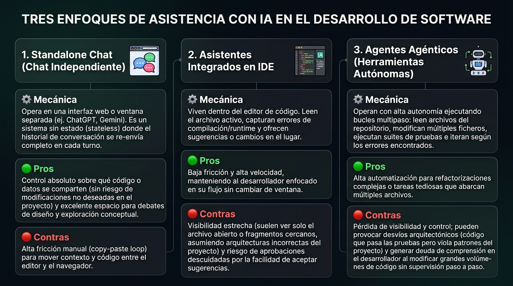

## **Pair Programmer Buddy:**

Socio técnico disponible 24/7 que ayuda a destrabar al desarrollador inmediatamente cuando se encuentra bloqueado, ofreciendo alternativas técnicas y encendiendo la inspiración para nuevas soluciones.

## **SDLC Asistido y Auto-Auditoría**

**Enfoque del ciclo de vida**

- Etapas completas: Planificación, Requisitos, Diseño, Desarrollo, Testing, Lanzamiento y Mantenimiento.
- Foco principal con IA: **Desarrollo** y **Testing/Auditoría**.

## **Qué es en criollo el tema:** 

Es programar en pareja con un modelo de lenguaje que tenés al lado como copiloto técnico 24/7. No reemplaza al desarrollador: vos seguís a cargo de la arquitectura y la lógica de negocio, mientras el modelo asume la fricción operativa de escribir sintaxis, refactorizar, armar tests y explicar código ajeno.

## **Qué problema resuelve:**

 Elimina los cuellos de botella del ciclo de desarrollo tradicional: perder horas descifrando dependencias rotas, batallando con sintaxis de librerías desconocidas, procrastinando la documentación o dejando código sin tests unitarios por falta de tiempo. Si no lo implementás, tu velocidad de prototipado e iteración queda atada al ritmo manual de tipeo y búsqueda en documentación.

**Técnicas clave:**

- **Estructura Priming - Pregunta - Decorador:** Divide el prompt en tres partes para gobernar el estilo y la salida. *Ejemplo:* `Priming: "Sos un experto en Python limpio"` + `Pregunta: "Creá un árbol AVL"` + `Decorador: "Comentá línea por línea y devolvé sólo el código"`.
- **Refactorización y Explicación de Código Legado:** Inyecta código complejo o heredado para desglosar su funcionamiento o traducirlo a patrones idiomáticos. *Ejemplo:* *"Explicá este script de 200 líneas en Swift que maneja punteros de memoria y generá su documentación técnica en Markdown"* .
- **Generación de Tests Unitarios y Casos de Borde:** Usa el rol de tester para obligar al modelo a encontrar dónde se rompe el código. *Ejemplo:* *"Actuá como software tester, identificá 3 edge cases de esta función y escribí los tests unitarios en pytest"*.
- **Revisión Pre-Pull Request con Contexto Desacoplado:** Audita ramas localmente antes de abrir el PR usando una sesión separada de la que generó el código. *Ejemplo:* *"Revisá este diff contra los criterios de aceptación del ticket DX-3 y reportá únicamente riesgos de seguridad o regresiones"*.

## **La trampa o error común:** 

Caer en la **aprobación ciega (** **rubber stamping** **)** y acumular **deuda de comprensión (** **comprehension debt** **)**. El modelo produce código sintácticamente impecable que parece funcionar pero puede esconder fallas lógicas sutiles, alucinaciones de librerías o agujeros de seguridad; si aceptás e integrás bloques que no entendés ni testeaste, te convertís en el cuello de botella del sistema y perdés el control de tu propia aplicación.

**No aplicar Separación de roles para revisión:** la ia que escribe codigo no es la misma que lo audita no le pidas al mismo chat/prompt que revise su propio código, porque tiende a confirmar sus propios errores.